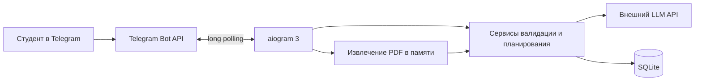

# Deadline Buddy AI

Telegram-бот, который помогает студенту понять условие учебного задания, получить чек-лист и распределить работу до дедлайна.

**Открыть бота:** [@Deadlinebud_bot](https://t.me/Deadlinebud_bot).

**Пользователю:** [пошаговая инструкция и отчёт](REPORT.md). **Владельцу:** [запуск, остановка и обслуживание](TELEGRAM.md).

## Запуск на Windows

Нужен Python 3.12 или новее. Откройте терминал PowerShell в папке проекта:

```powershell
python -m venv .venv
.\.venv\Scripts\python.exe -m pip install -r backend/requirements.lock.txt
Copy-Item backend/.env.example backend/.env
```

Если `.env` уже заполнен, не копируйте пример поверх него. Укажите в `backend/.env`:

```dotenv
BOT_TOKEN=токен_от_BotFather
TELEGRAM_BOT_USERNAME=Deadlinebud_bot
LLM_API_KEY=ваш_ключ
LLM_BASE_URL=https://deepcode.ci.nsu.ru/api
LLM_MODEL=Qwen3.8-27B
BOT_DATABASE_PATH=telegram.sqlite3
BOT_TIMEZONE=Europe/Moscow
```

Для другого бота измените и токен, и ожидаемое имя. Старое имя переменной `TELEGRAM_BOT_TOKEN` тоже поддерживается; `BOT_TOKEN` имеет приоритет. Указывать оба не нужно.

Проверки и запуск:

```powershell
.\.venv\Scripts\python.exe backend/telegram_bot.py --check
.\.venv\Scripts\python.exe backend/check_ai.py
.\Start-Bot.ps1
Get-Content .runtime/bot.log -Tail 20
```

`--check` проверяет имя бота и наличие webhook, не получает сообщения и не меняет настройки. `check_ai.py` делает настоящий разбор учебного примера через настроенную модель. Успех: `OK sample=1 ...`. Для трёх заданий: `backend/check_ai.py --all`.

`Start-Bot.ps1` запускает процесс в фоне. Строка `Polling started` означает подключение к Telegram; она не заменяет проверку ИИ. Остановка:

```powershell
.\Stop-Bot.ps1
```

Для запуска в открытом терминале Windows или Linux:

```sh
python backend/runner.py
```

Предварительно активируйте созданное виртуальное окружение. Linux: `python3 -m venv .venv`, затем `source .venv/bin/activate` и установка зависимостей. Скрипты `.ps1` нужны только для Windows.

## Что реализовано

- Приём текста и PDF с текстовым слоем, извлечение цели, требований и ограничений внешней моделью.
- Чек-лист из 3–12 шагов с inline-кнопками и сохранением отметок.
- Дедлайн, даты шагов и отдельный просмотр задач на сегодня.
- Один текущий план на пользователя, доступный на его устройствах через Telegram.
- Сессия 14 дней с последней активности, удаление по `/delete`.
- Длинные условия: `/new` → несколько сообщений → `/analyze`.
- Ошибки на понятном языке, общий таймаут разбора 29 секунд, до пяти одновременных разборов и один на пользователя.

Команды: `/start`, `/help`, `/plan`, `/today`, `/deadline`, `/new`, `/analyze`, `/cancel`, `/privacy`, `/delete`.

## Архитектура



`backend/telegram_bot.py` — сообщения, команды и кнопки. `backend/services.py` — проверка входа, вызов модели, SQLite и даты. `backend/runner.py` — блокировка второго экземпляра и перезапуск при ошибке запуска. `backend/check_ai.py` — независимая проверка реальной модели.

Схема БД: `sessions(telegram_user_id, created_at, last_seen_at, expires_at)` → `plans` → `requirements`, `steps`. Внешние ключи включены, удаление каскадное. ID шагов не переиспользуются после замены плана: старые кнопки получают ошибку, а не меняют новый шаг. Любое изменение проверяет владельца по Telegram ID. В группах бот не обрабатывает задания.

Публичный веб-сервер для бота не запускается. Сайт предыдущей версии сохранён в `legacy/` как архив и не участвует в текущем запуске.

## Данные и настройки

Секреты только в `backend/.env`; БД, логи и `.runtime` исключены из Git и Docker-контекста. В репозитории есть только пустой `.env.example`. Не публикуйте свой `.env`, базу и файлы из `.runtime`.

Исходное условие не записывается в SQLite и логи. PDF скачивается в ограниченный буфер памяти, используется для извлечения текста и не создаёт файл на диске. Текст передаётся LLM-провайдеру. Срок хранения на стороне провайдера определяется им. Сообщения в Telegram остаются в чате; команда `/delete` удаляет данные только из базы бота.

Черновики `/new` и ожидание даты находятся в памяти, истекают через 15 минут без ввода; перезапуск их сбрасывает. Сохранённый план переживает перезапуск. Очистка истёкших сессий — при старте, обращении и раз в минуту.

`backend/config.yaml` задаёт лимиты и параметры модели, `backend/prompts/analyze.txt` — системный промпт. Деморежима в Telegram-версии нет.

## Решения по неоднозначностям ТЗ

- Текст свыше 20 000 символов отклоняется, а не обрезается: это сохраняет требования в конце условия.
- Дата принимается командой `/deadline YYYY-MM-DD` или отдельной строкой `Дедлайн: YYYY-MM-DD` / `YYYY-MM-DD` в условии. Даты внутри предложения не трактуются как срок автоматически.
- В подписи PDF только дата считается метаданными. Если в подписи есть условие, анализируется оно, а файл игнорируется по правилу приоритета текста из ТЗ.
- Шаги распределяются от сегодня до дедлайна включительно, по формуле `floor(i * число_дней / (число_шагов - 1))`. Последний шаг приходится на дедлайн. При коротком сроке несколько шагов в день; при длинном возможны свободные дни.
- Дедлайн сегодня допустим: все шаги на сегодня. Смена даты сохраняет `done`.
- Промпт просит 5–12 шагов, валидатор допускает 3–12 согласно контракту ТЗ.
- HTTP-таймаут модели 25 секунд, весь разбор 29 секунд, включая скачивание и извлечение PDF. Один повтор некорректного JSON укладывается в общий бюджет.
- Таймзона по умолчанию `Europe/Moscow`, независимо от системного часового пояса.
- Локальный ПК вместо VPS — выбранный владельцем вариант размещения. Для доступности компьютер, процесс бота и подключение к сервисам должны работать. После перезагрузки запустите `Start-Bot.ps1` снова; автоматический запуск при входе в Windows не установлен.

## Проверки

```powershell
.\.venv\Scripts\python.exe -m pytest -q
```

Тесты используют временную SQLite и HTTP-заглушки, не реальные ключи. Проверяется также полный сценарий через настоящий диспетчер aiogram: текст → кнопка шага → дата → сегодня → составное условие → удаление. Это проверка обработчиков и контрактов, а не замена теста живого провайдера.

[Проверки и ручной сценарий приёмки](docs/TESTING.md).

Официальные справочники: [aiogram long polling](https://docs.aiogram.dev/en/latest/dispatcher/long_polling.html), [Open WebUI API](https://docs.openwebui.com/reference/api-endpoints/).

## Контейнерный запуск

Как дополнительный вариант подготовлены Dockerfile и compose.yaml: `docker compose up --build -d`. Перед этим заполните `.env` и остановите локальный экземпляр. Порты не публикуются, база хранится в volume `bot-data`. Docker-развёртывание в текущей проверке не выполнялось.

При раздельной маршрутизации Telegram/ИИ настройте `TELEGRAM_PROXY` и `LLM_LOCAL_ADDRESS`: [подробности](TELEGRAM.md#раздельное-подключение-telegram-и-ии).
